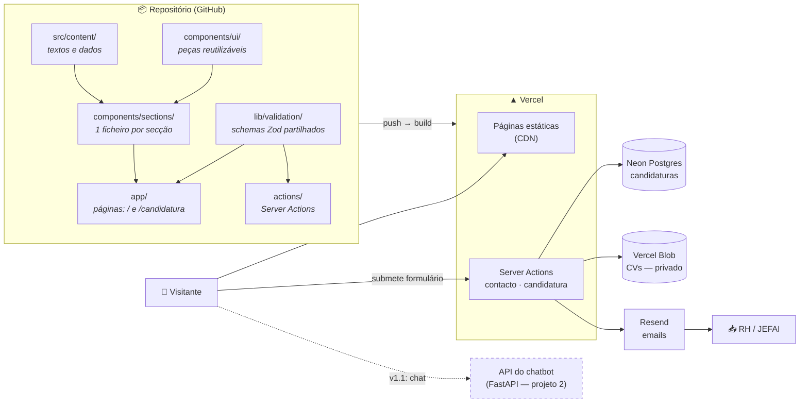
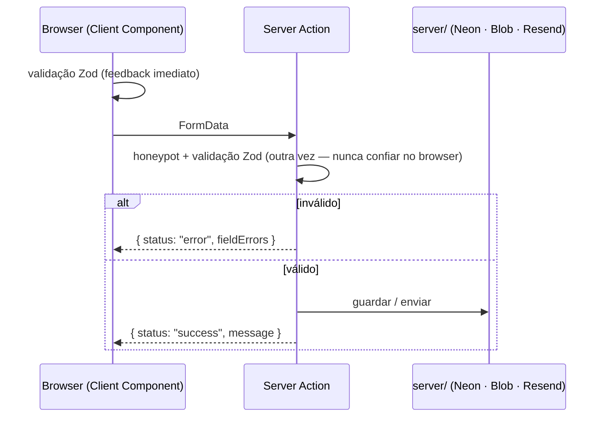
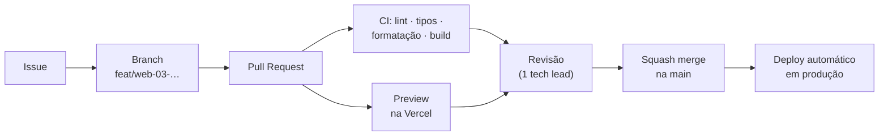

# Arquitetura

## Em 30 segundos

O site é uma aplicação **Next.js alojada na Vercel**. As páginas são geradas como **HTML estático** no build. Só **duas coisas correm no servidor**: os formulários de **contacto** e de **candidatura**, implementados como **Server Actions**. Os dados das candidaturas ficam no **Neon Postgres**, os CVs no **Vercel Blob** (privado), e os emails saem pelo **Resend**.

## Camadas do código

| Camada          | Pasta                 | Responsabilidade                                                                       | Quem mexe                     |
| --------------- | --------------------- | -------------------------------------------------------------------------------------- | ----------------------------- |
| **Conteúdo**    | `src/content/`        | Todo o texto, listas, links e mensagens dos formulários                                | Qualquer pessoa               |
| **Componentes** | `src/components/`     | Apresentação. `ui/` = peças genéricas; `sections/` = uma secção da página por ficheiro | Equipa de desenvolvimento     |
| **Páginas**     | `src/app/`            | Rotas (`/`, `/candidatura`, `/privacidade`), layout comum, metadata, tokens            | Tech leads + quem tem a issue |
| **Contratos**   | `src/lib/validation/` | Schemas Zod: o que um formulário pode enviar. Usados **no cliente e no servidor**      | Tech leads                    |
| **Ações**       | `src/actions/`        | Server Actions: recebem o formulário, validam, chamam `server/`                        | Seniores                      |
| **Integrações** | `src/server/`         | Clientes de Neon, Blob e Resend. Só servidor (`import "server-only"`)                  | Seniores                      |

**Regras de dependência**

- `app → sections → ui`; `sections → content`.
- `ui/` nunca importa de `content/`, `sections/` nem `actions/`.
- `server/` só é importado por `actions/`, nunca por componentes. O `import "server-only"` garante-o: se for importado no cliente, a build falha.

### Porque é que isto importa

- **Trabalho em paralelo:** cada secção é um ficheiro. E o formulário de candidatura (UI) e o backend (BD, Blob, email) avançam ao mesmo tempo, porque o **contrato** (`lib/validation/application.ts` + `lib/forms.ts`) já está definido.
- **Separação conteúdo/código:** mudar textos não exige perceber React.
- **Segurança por defeito:** a validação corre sempre no servidor, e as chaves e os dados pessoais nunca chegam ao browser.

## Server vs Client Components

Por defeito, **Server Components**: são renderizados no build e não enviam JavaScript para o browser. Só levam `"use client"` os componentes com estado ou eventos:

| Componente                | Porquê                                                    | Issue  |
| ------------------------- | --------------------------------------------------------- | ------ |
| Tabs dos departamentos    | Tab selecionada                                           | WEB-06 |
| Menu mobile               | Aberto/fechado                                            | WEB-07 |
| Formulário de contacto    | `useActionState`, erros por campo                         | WEB-08 |
| Formulário de candidatura | `useActionState`, erros por campo, contador de caracteres | WEB-24 |

## Fluxo de um formulário

O contrato de resposta é sempre o tipo `FormState` (`src/lib/forms.ts`).

## Fluxo de trabalho → produção

> Os previews usam variáveis de ambiente **de Preview**, ligadas a uma base de dados e a uma store de Blob **de teste**, nunca às de produção. Assim, testar um PR não mistura dados falsos com candidaturas reais.

## Ligação ao projeto 2 (chatbot)

O chatbot é um **serviço separado** (Python/FastAPI, repositório próprio). No site entra apenas como widget (Client Component) que comunica com a API do chatbot.

## Decisões

- [ADR 0001 — Stack e alojamento](adr/0001-stack-e-alojamento.md)
- [ADR 0002 — Candidaturas no próprio site](adr/0002-candidaturas-no-site.md)
